# Product-Order Microservices

## Developers

| Name | Role |
| --- | --- |
| Hüseyin Erekmen | Dispatcher, authorization, test infrastructure, monitoring, and load testing |
| Rana Karagöl | Auth, Product, and Order services, data models, repository/service layers, and service tests |

## Last Updated

April 5, 2026

## Table of Contents

1. [Overview](#overview)
2. [Problem Statement](#problem-statement)
3. [Goals](#goals)
4. [Tech Stack](#tech-stack)
5. [System Architecture](#system-architecture)
6. [Service Responsibilities](#service-responsibilities)
7. [Dispatcher / Gateway Logic](#dispatcher--gateway-logic)
8. [Authentication and Authorization](#authentication-and-authorization)
9. [Database Isolation](#database-isolation)
10. [Network Isolation](#network-isolation)
11. [Docker and Orchestration](#docker-and-orchestration)
12. [API Design](#api-design)
13. [Richardson Maturity Model Level 2](#richardson-maturity-model-level-2)
14. [Complexity Notes](#complexity-notes)
15. [Endpoint Summary](#endpoint-summary)
16. [Layered Architecture](#layered-architecture)
17. [Class Diagram](#class-diagram)
18. [Request Flows](#request-flows)
19. [Sequence Diagrams](#sequence-diagrams)
20. [Testing Approach](#testing-approach)
21. [TDD on the Dispatcher](#tdd-on-the-dispatcher)
22. [Development Process Summary](#development-process-summary)
23. [Contribution Breakdown](#contribution-breakdown)
24. [Monitoring and Observability](#monitoring-and-observability)
25. [Load Testing](#load-testing)
26. [Achievements](#achievements)
27. [Limitations](#limitations)
28. [Future Improvements](#future-improvements)
29. [Conclusion](#conclusion)

---

## Overview

This is a two-person team project implementing a microservices backend for a product and order management scenario. The system exposes a single public entry point — a Dispatcher acting as an API gateway — which routes traffic to three internal services: Auth, Product, and Order.

## Problem Statement

In a monolithic setup, authentication, product management, order management, and routing all live in the same codebase. This leads to:

- Mixed responsibilities and increasing maintenance cost
- Scattered security and authorization logic
- No centralized observability or metrics collection
- No independent scaling per service
- Weak service boundaries due to a shared database

This project addresses these problems through clear microservice boundaries and a centralized Dispatcher.

## Goals

- Build a four-unit architecture: Dispatcher, Auth Service, Product Service, and Order Service
- Position the Dispatcher as the single business API entry point
- Give each service its own isolated NoSQL persistence boundary
- Apply RESTful, RMM Level 2-compliant endpoint contracts
- Make TDD visible on the Dispatcher side
- Establish a measurable baseline for monitoring (Prometheus + Grafana) and load testing (Locust)

## Tech Stack

| Category | Technology | Purpose |
| --- | --- | --- |
| Backend framework | FastAPI | HTTP API, route definitions, validation integration |
| Language | Python 3.11 | Service logic, business rules, tests |
| Validation | Pydantic | Request/response schemas and field validation |
| Database | MongoDB | Per-service NoSQL persistence |
| MongoDB client | Motor | Async database access |
| Containerization | Docker | Isolated service execution |
| Orchestration | Docker Compose | Multi-service and profile management |
| Testing | Pytest | Service and Dispatcher behavior tests |
| HTTP client | httpx | Dispatcher proxy and test client |
| Auth | python-jose, bcrypt | JWT generation/validation and password hashing |
| Observability | Prometheus, Grafana | Metrics collection and dashboard visualization |

## System Architecture

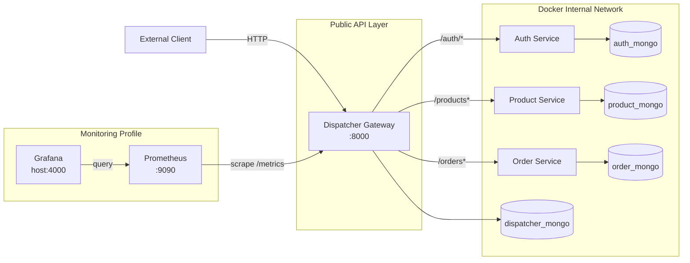

## Service Responsibilities

### 1) Dispatcher
- The sole public-facing entry point.
- Routes `/auth`, `/products`, and `/orders` traffic to the corresponding internal services.
- Applies centralized authorization on all product and order requests.
- Stores traffic logs and access profile data in its own persistence boundary.
- Exposes a `/metrics` endpoint for Prometheus scraping.

### 2) Auth Service
- Handles user registration (`POST /register`) and login (`POST /login`).
- Issues JWT tokens and provides token verification (`GET /verify-token`).
- Manages password hashing and validation.

### 3) Product Service
- Handles full product CRUD:
  - `GET /products`
  - `GET /products/{id}`
  - `POST /products`
  - `PUT /products/{id}`
  - `PATCH /products/{id}`
  - `DELETE /products/{id}`

### 4) Order Service
- Handles order CRUD and lifecycle management:
  - `GET /orders`
  - `GET /orders/{id}`
  - `POST /orders`
  - `PATCH /orders/{id}`
  - `DELETE /orders/{id}`
- Computes `total_amount` from the order item list.

## Dispatcher / Gateway Logic

The Dispatcher abstracts internal services from the outside world and acts as the API gateway layer.

Core behavior:
- Routes are registered centrally: `/auth/{path:path}`, `/products`, `/orders`.
- Token and access profile validation runs at middleware level for all protected resources.
- Upstream response status codes and body semantics are preserved where possible.
- Returns `503 Service Unavailable` on upstream connection failures and `500 Internal Server Error` for unexpected internal errors.

Route mapping:

| Dispatcher (external) | Internal target |
| --- | --- |
| `/auth/{path}` | `auth_service/{path}` |
| `/products...` | `product_service/products...` |
| `/orders...` | `order_service/orders...` |

## Authentication and Authorization

### Authentication
- Users obtain a token via `POST /auth/register` and `POST /auth/login`.
- All `/auth/*` calls pass through the Dispatcher to the Auth Service.

### Authorization
- The Dispatcher enforces protection on `/products` and `/orders` prefixes.
- Missing or invalid tokens return `401 Unauthorized`.
- A valid token without the required method permission returns `403 Forbidden`.
- Access profiles are stored in the Dispatcher's own `access_profiles` collection.
- The default `default-authenticated` profile grants read-only access.

## Database Isolation

Each service has its own dedicated MongoDB container rather than sharing a single database instance.

| Unit | Mongo Service | Default DB | Boundary |
| --- | --- | --- | --- |
| Auth Service | `auth_mongo` | `auth_db` | Identity data |
| Product Service | `product_mongo` | `product_db` | Product data |
| Order Service | `order_mongo` | `order_db` | Order data |
| Dispatcher | `dispatcher_mongo` | `dispatcher_db` | Traffic logs + access profiles |

This enforces persistence boundaries and prevents direct cross-service database access.

## Network Isolation

All services are attached to `internal_network` in `docker-compose.yml`.

- Auth, Product, and Order services do not publish host ports.
- MongoDB containers do not publish host ports.
- The only public-facing port is the Dispatcher on `8000:8000`.
- When the monitoring profile is active, Prometheus (`9090`) and Grafana (`4000 → 3000`) are also published for observation.

Internal services are not designed as public endpoints — they run exclusively behind the gateway.

## Docker and Orchestration

All commands are run from the repo root directory.

### Starting the runtime
```powershell
docker compose -f src/docker-compose.yml up --build
```

Service status in Docker Compose:

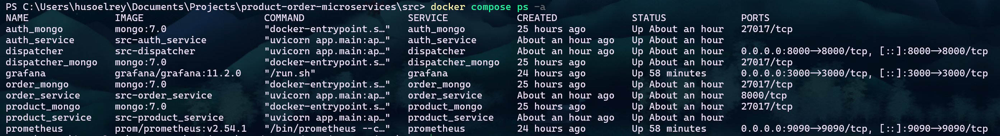

### Starting the monitoring profile
```powershell
docker compose -f src/docker-compose.yml --profile monitoring up -d prometheus grafana
```

### Running tests in containers
```powershell
docker compose -f src/docker-compose.yml --profile test run --rm auth_tests
docker compose -f src/docker-compose.yml --profile test run --rm dispatcher_tests
docker compose -f src/docker-compose.yml --profile test run --rm product_tests
docker compose -f src/docker-compose.yml --profile test run --rm order_tests
```

## API Design

The API follows a resource-oriented design and presents a unified surface through the Dispatcher.

Design principles:
- Resource-based URL structures: `/products`, `/orders`, `/auth/...`
- HTTP methods used according to their intended semantics
- Appropriate status codes per response type
- Field validation on all request/response schemas via Pydantic

HTTP method usage:

- `GET` — listing and detail reads
- `POST` — resource creation or auth flow initiation
- `PUT` — full resource replacement
- `PATCH` — partial update
- `DELETE` — resource removal

## Richardson Maturity Model Level 2

This project meets RMM Level 2 by:

- Using resource-oriented URIs instead of action-based single endpoints.
- Splitting operations across HTTP methods.
- Reflecting semantic differences through method and status code combinations.

## Complexity Notes

The project is dominated by network routing, authorization, and CRUD flows rather than heavy algorithmic processing.

- Dispatcher route matching operates over a fixed set of prefixes, so routing is constant time. The main practical cost is upstream network latency.
- Authorization checks a fixed set of protected prefixes. The permission scan within an access profile is O(p) where p is the number of permissions — small and bounded in this project.
- Order total calculation is a single-pass sum over the item list: O(n) where n is the number of items.
- Listing endpoints scale with the number of records returned; the real bottleneck in practice is database I/O and network transfer.

These notes should be read alongside the load test and monitoring results, where performance is assessed through measured latency and failure rates.

## Endpoint Summary

### External contract (via Dispatcher)

| Method | Endpoint | Description |
| --- | --- | --- |
| GET | `/` | Dispatcher health check |
| GET | `/metrics` | Prometheus metrics endpoint |
| GET/POST/PUT/PATCH/DELETE | `/auth/{path}` | Proxy to Auth Service |
| GET | `/products` | List products |
| POST | `/products` | Create product |
| GET | `/products/{id}` | Get product detail |
| PUT | `/products/{id}` | Full product update |
| PATCH | `/products/{id}` | Partial product update |
| DELETE | `/products/{id}` | Delete product |
| GET | `/orders` | List orders |
| POST | `/orders` | Create order |
| GET | `/orders/{id}` | Get order detail |
| PATCH | `/orders/{id}` | Partial order update |
| DELETE | `/orders/{id}` | Delete order |

### Internal service endpoints

| Service | Endpoints |
| --- | --- |
| Auth Service | `POST /register`, `POST /login`, `GET /verify-token` |
| Product Service | `GET/POST /products`, `GET/PUT/PATCH/DELETE /products/{id}` |
| Order Service | `GET/POST /orders`, `GET/PATCH/DELETE /orders/{id}` |

### Status code reference

| Code | Meaning | Typical scenario |
| --- | --- | --- |
| 200 | OK | List, detail, login |
| 201 | Created | Product or order creation |
| 204 | No Content | Delete operations |
| 401 | Unauthorized | Missing or invalid token |
| 403 | Forbidden | Valid token, insufficient permission |
| 404 | Not Found | Invalid ID or route |
| 405 | Method Not Allowed | Unsupported method for the resource |
| 409 | Conflict | Duplicate username on registration |
| 422 | Unprocessable Entity | Schema or field validation failure |
| 500 | Internal Server Error | Unexpected Dispatcher error |
| 503 | Service Unavailable | Upstream connection failure |

## Layered Architecture

Layers are separated per service:

- **Router / Controller** — HTTP endpoint definitions and status code handling
- **Service** — Business logic and flow management
- **Repository** — Database access
- **Schema** — Validation contracts
- **Model** — Domain objects
- **Core** — Shared infrastructure: security, metrics, database connections

This separation keeps business logic out of route handlers and makes each layer independently testable.

## Class Diagram

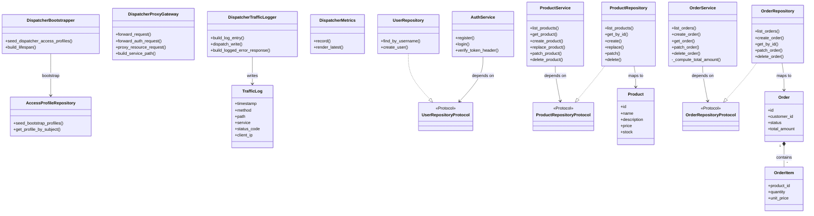

## Request Flows

### Flow 1: Login
1. The client calls `POST /auth/login` through the Dispatcher.
2. The Dispatcher forwards the request to the Auth Service.
3. The Auth Service validates credentials and issues a JWT token.
4. The Dispatcher returns the response to the client.

### Flow 2: Authorized product read
1. The client calls `GET /products` with `Authorization: Bearer <token>`.
2. The Dispatcher validates the token and checks the access profile.
3. If authorized, the request is forwarded to the Product Service.
4. The product list is returned to the client.

### Flow 3: Unauthorized write request
1. The client calls `POST /products` with a valid token that lacks write permission.
2. The Dispatcher checks the method permission in the access profile.
3. Without permission, `403 Forbidden` is returned without forwarding to the downstream service.

### Flow 4: Upstream service outage
1. The client calls a protected endpoint.
2. After authorization, the Dispatcher attempts to forward to the target service.
3. If the upstream is unreachable, `503 Service Unavailable` is returned.

## Sequence Diagrams

### Login and token retrieval
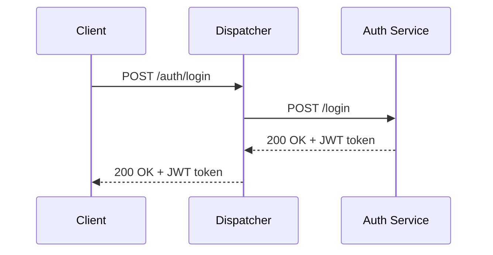

### Authorization check on a protected write request
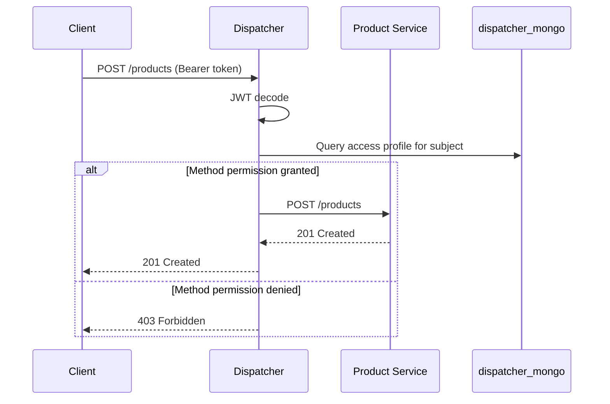

## Testing Approach

Tests are layered and behavior-focused across the project.

- Service tests use fake collections to minimize database dependency.
- Dispatcher tests cover authorization logic, proxy forwarding, error semantics, logging, and metrics behavior.
- Product and Order service tests cover CRUD flows and edge cases such as 404 and 204 responses.
- Auth service tests cover the core register, login, and verify-token flows.

TDD was applied most consistently on the Dispatcher side. The rest of the project does not maintain the same level of test-first discipline throughout.

## TDD on the Dispatcher

A test → implement → refine cycle was applied to gateway behaviors on the Dispatcher.

Key areas:
- Preserving `503` semantics on upstream service failures
- Distinguishing `500` behavior for Dispatcher-internal errors
- Preventing false positives from prefix matching on protected routes
- Producing Prometheus request metrics at the Dispatcher level

## Development Process Summary

| Flow | Focus | Outcome |
| --- | --- | --- |
| Upstream error handling | Downstream service unreachability | Gateway returns `503` consistently |
| Internal error handling | Dispatcher error distinction | Unexpected gateway errors are classified as `500` |
| Route guard accuracy | Protected path matching | Only the target resource prefixes are protected |
| Dispatcher metrics | Request counting and latency | Prometheus-compatible metrics produced |

## Contribution Breakdown

| Developer | Primary areas |
| --- | --- |
| Hüseyin Erekmen | Dispatcher, authorization, test infrastructure, monitoring, and load testing |
| Rana Karagöl | Auth, Product, and Order services, data models, repository/service layers, and service tests |

Both developers contributed actively to different layers of the architecture.

## Monitoring and Observability

The monitoring stack is built on Prometheus and Grafana.

### Prometheus
- Scrapes the Dispatcher's `/metrics` endpoint.
- Collects request counts, status code distribution, and latency histograms.

### Grafana dashboard
The provisioned `Dispatcher Overview` dashboard includes:
- `Requests (15m)`
- `Status Codes (15m)`
- `Request Latency P95`

### Monitoring outputs

#### Grafana dashboard
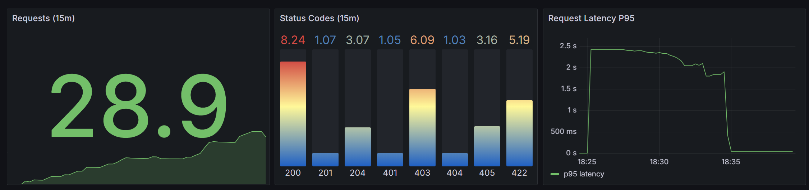

#### Prometheus target health
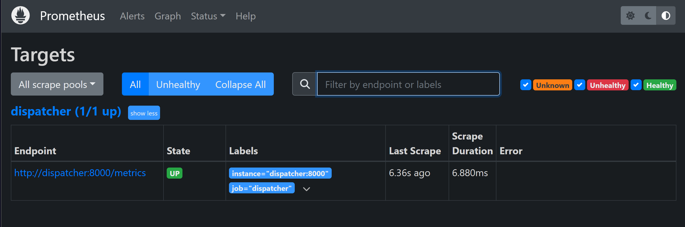

#### Prometheus status code query
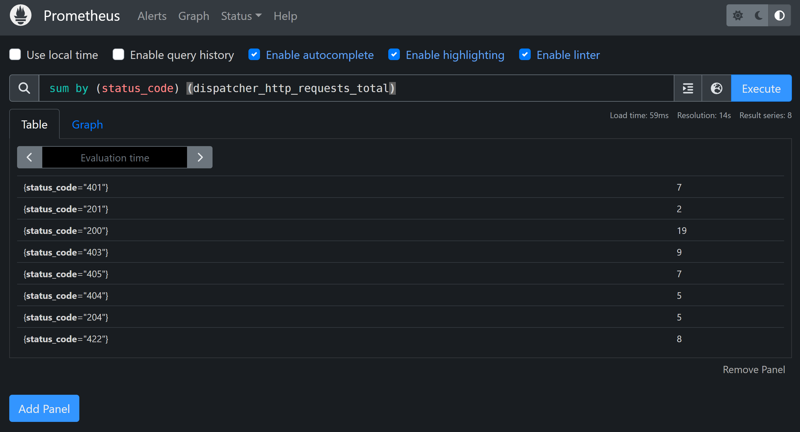

#### Notes
- The Grafana dashboard presents request volume, status codes, and latency on a single screen.
- The Prometheus target page confirms that the Dispatcher's `/metrics` endpoint is being scraped successfully.
- Status code queries show that metrics are collected correctly and multiple response codes are observable.
- Query values are cumulative counters and are used as supporting observations rather than primary performance benchmarks.

### Traffic log table

Traffic logs are stored in the `traffic_logs` collection in `dispatcher_db`. The table below shows that different request types can be monitored centrally.

Query used to generate the output:
```powershell
docker exec dispatcher_mongo mongosh --% "mongodb://localhost:27017/dispatcher_db" --quiet --eval "console.table(db.traffic_logs.find({path: {$ne: '/metrics'}}, {_id:0, timestamp:1, method:1, path:1, service:1, status_code:1, client_ip:1}).sort({timestamp:-1}).limit(20).toArray())"
```

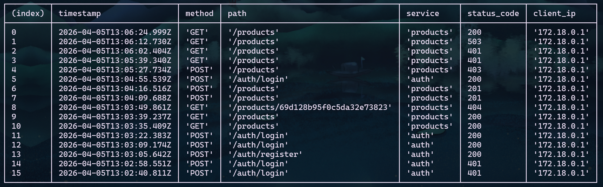

Logged fields: `timestamp`, `method`, `path`, `service`, `status_code`, `client_ip`.

The log captures successful requests (`200`, `201`) alongside unauthorized access (`401`), insufficient permission (`403`), not found responses (`404`), and upstream failures (`503`) in the same collection. The `/metrics` path is filtered out to keep business API traffic readable.

### API outputs (Postman / manual tests)

#### Login request
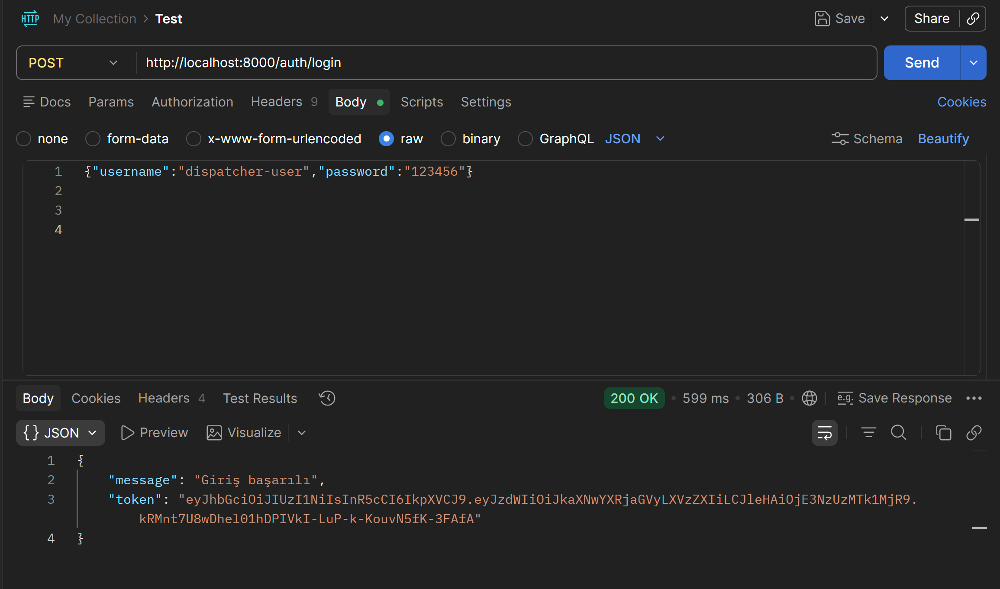

#### Successful delete (`204 No Content`)
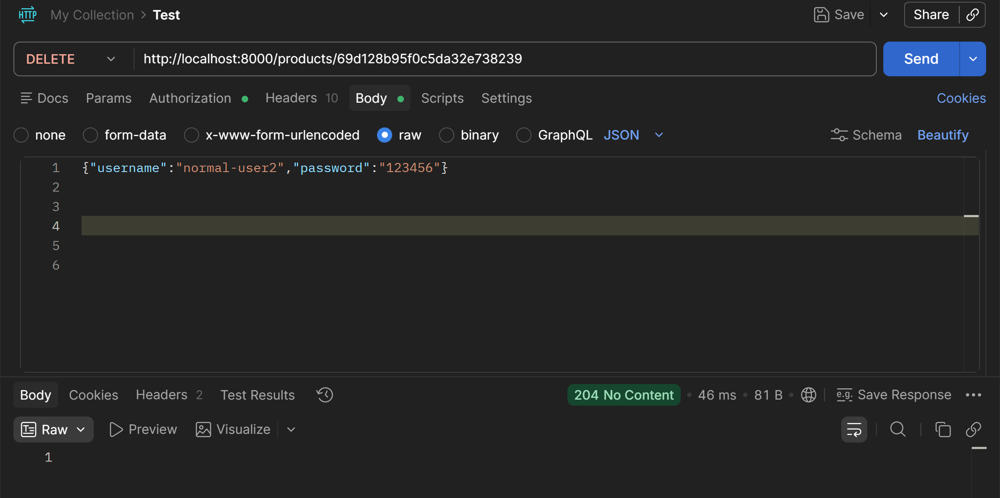

#### Unauthorized request (`401`)
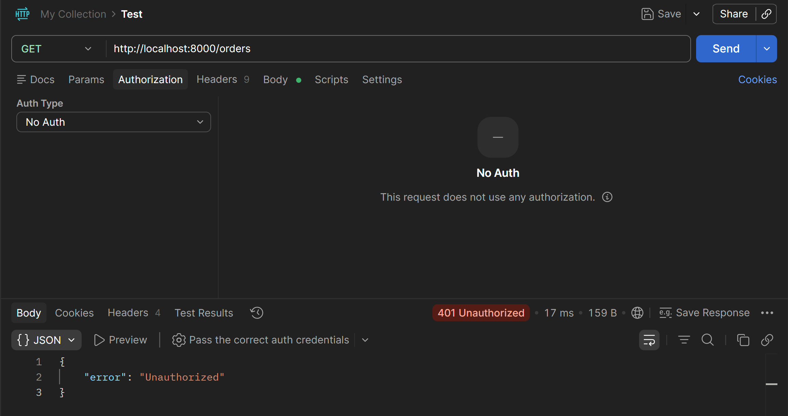

#### Forbidden request (`403`)
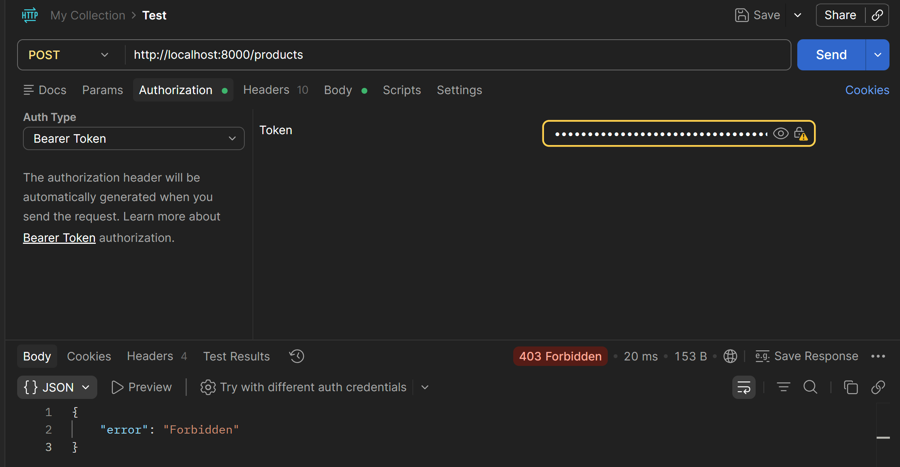

#### Not found (`404`)
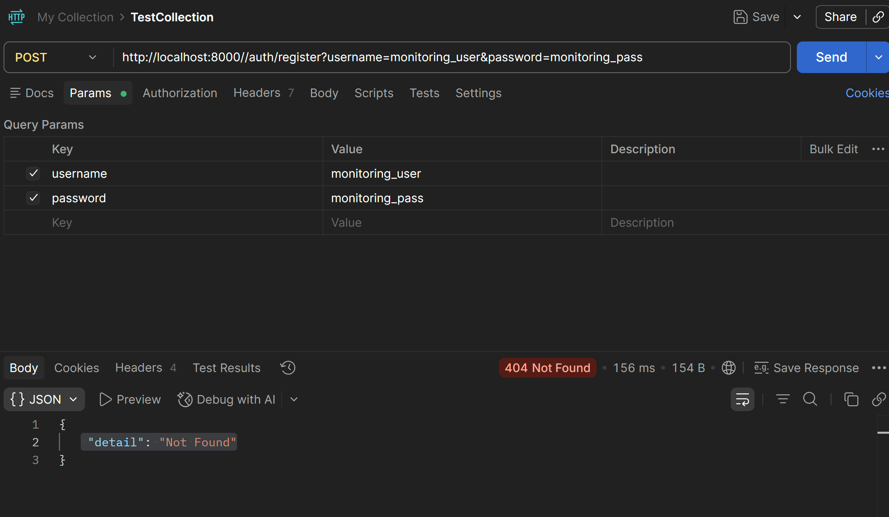

## Load Testing

Concurrent traffic was generated against the Dispatcher using Locust. For each scenario, Locust stats, Grafana panels, and Prometheus status code queries were captured together.

### Running Locust

```powershell
python -m locust -f .\load_tests\locustfile.py --host http://localhost:8000
```

Headless benchmark:
```powershell
python -m locust -f .\load_tests\locustfile.py --host http://localhost:8000 --headless --users 100 --spawn-rate 10 --run-time 3m
```

### Methodology

Tests were run incrementally at 20, 50, 100, and 300 concurrent users. The primary benchmark set is 20/50/100 users; the 300-user run is a separate stress test. The Locust `Aggregated` row is the reference metric for comparisons. Prometheus status code queries produce cumulative counters and are treated as supporting observations.

### Benchmark comparison (20 / 50 / 100 users)

| Test | Users | Spawn Rate | Total Requests | Failures | Failure Rate | Avg | Median | P95 | P99 | RPS |
| --- | --- | --- | --- | --- | --- | --- | --- | --- | --- | --- |
| 20 users | 20 | 2/s | 1,842 | 0 | 0% | 15.38 ms | 13 ms | 24 ms | 110 ms | 9.2 |
| 50 users | 50 | 5/s | 4,604 | 0 | 0% | 15.54 ms | 12 ms | 24 ms | 140 ms | 26.8 |
| 100 users | 100 | 10/s | 9,206 | 0 | 0% | 17.10 ms | 11 ms | 34 ms | 170 ms | 49.8 |

### 20-user test

Config: 20 users, spawn rate 2/s

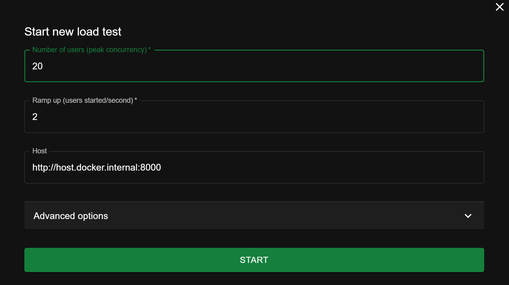
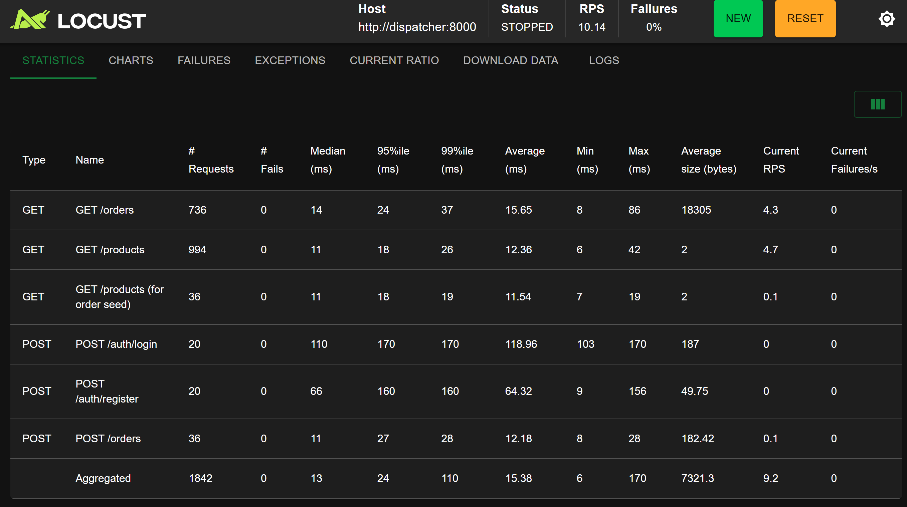
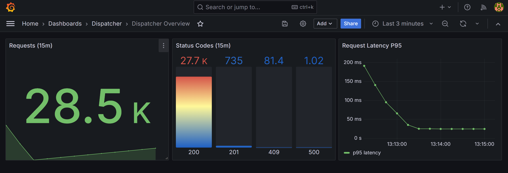
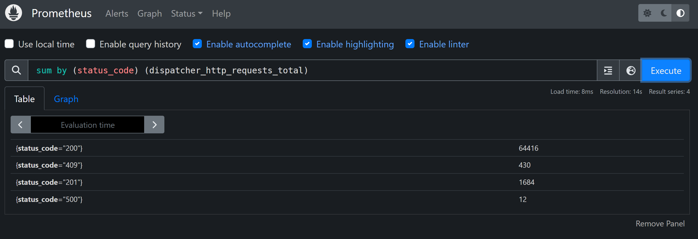

- Total: 1,842 requests, 0 failures
- Avg: 15.38 ms · Median: 13 ms · P95: 24 ms · P99: 110 ms · RPS: 9.2
- Read endpoints stayed low — `GET /products` avg 12.36 ms, `GET /orders` avg 15.65 ms
- Auth endpoints were slower — `POST /auth/login` avg 118.96 ms, `POST /auth/register` avg 64.32 ms

### 50-user test

Config: 50 users, spawn rate 5/s

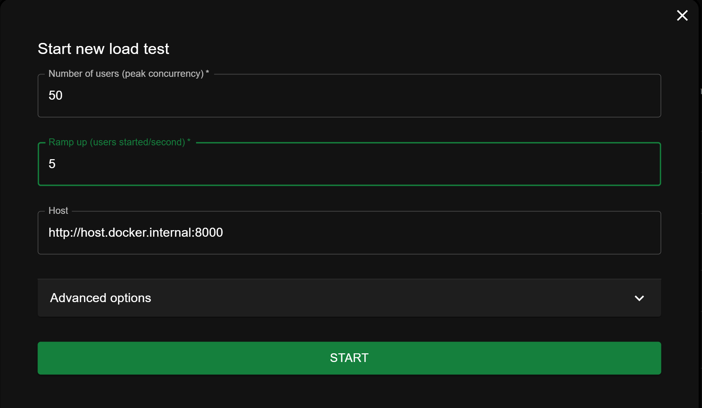

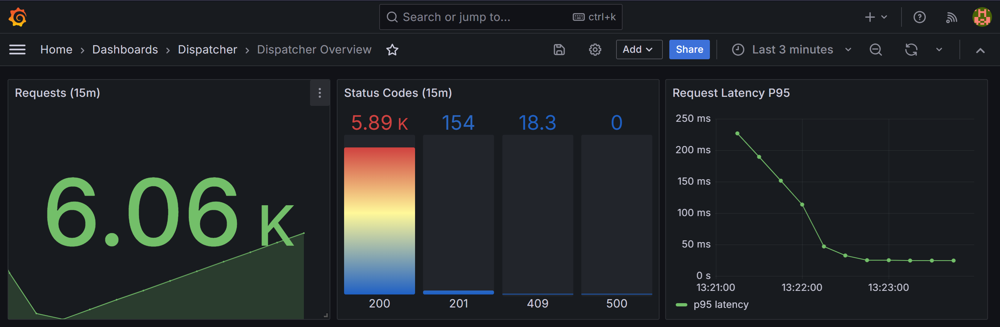


- Total: 4,604 requests, 0 failures
- Avg: 15.54 ms · Median: 12 ms · P95: 24 ms · P99: 140 ms · RPS: 26.8
- Read endpoints held their latency band — `GET /products` avg 11.79 ms, `GET /orders` avg 14.64 ms
- Auth endpoints remained slower — `POST /auth/login` avg 141.31 ms, `POST /auth/register` avg 127.42 ms

### 100-user test

Config: 100 users, spawn rate 10/s

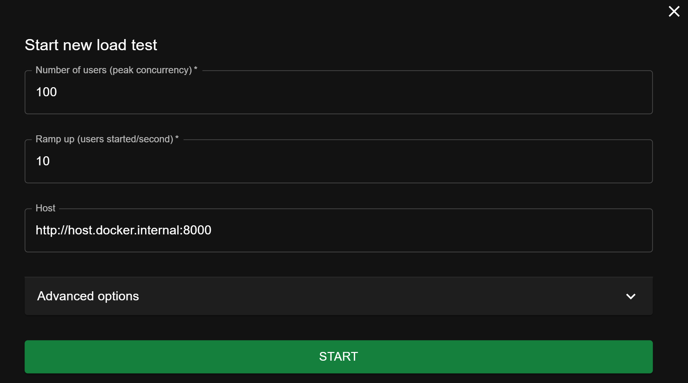

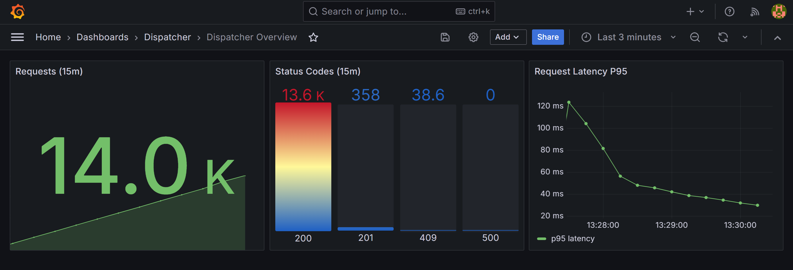
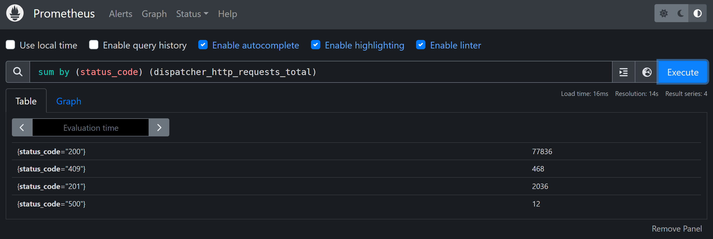

- Total: 9,206 requests, 0 failures
- Avg: 17.10 ms · Median: 11 ms · P95: 34 ms · P99: 170 ms · RPS: 49.8
- Read endpoints remained stable — `GET /products` avg 12.50 ms, `GET /orders` avg 15.24 ms
- Auth endpoints continued to lag — `POST /auth/login` avg 159.21 ms, `POST /auth/register` avg 189.72 ms

Zero failures and controlled P95/P99 at 100 users indicate the system held up well at this load level.

### 300-user stress test

Config: 300 users, spawn rate 20/s

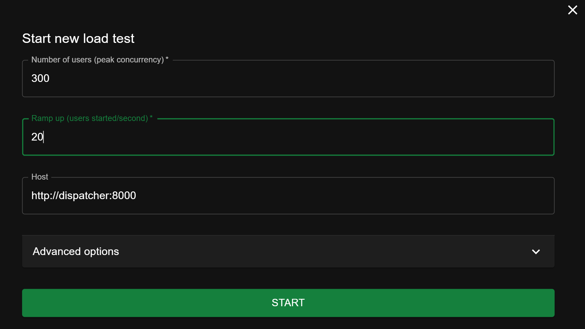
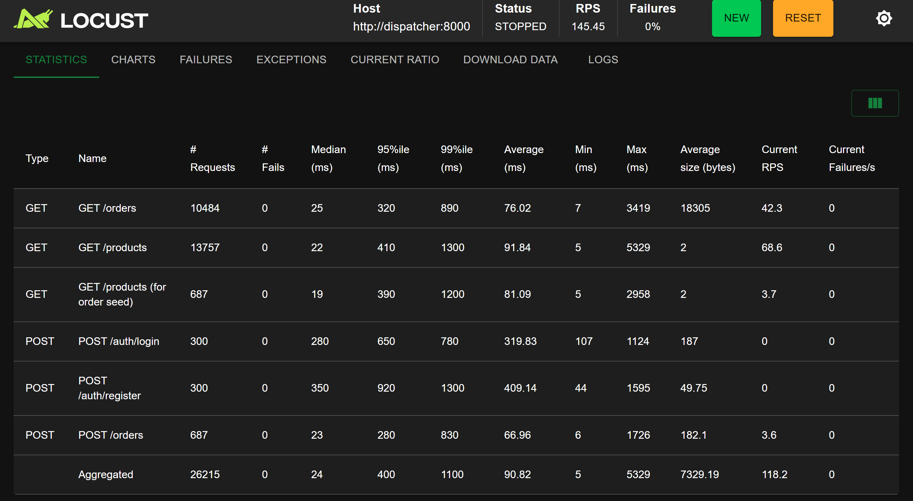
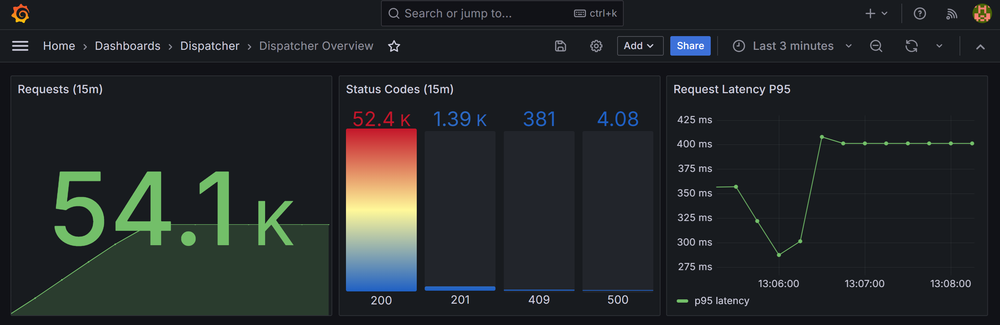


- Total: 26,215 requests, 0 failures
- Avg: 90.82 ms · Median: 24 ms · P95: 400 ms · P99: 1,100 ms · RPS: 118.2
- Auth endpoints spiked — `POST /auth/login` avg 319.83 ms, `POST /auth/register` avg 409.14 ms
- Read endpoints also showed increased latency — `GET /products` avg 91.84 ms, `GET /orders` avg 76.02 ms

The system kept running without errors at this level, but latency rose sharply. This test is treated as a durability observation rather than a primary benchmark.

### Summary

- The 20/50/100-user tests showed stable, low-latency performance with a 0% failure rate throughout.
- Auth endpoints consistently produced higher latency than read endpoints at all load levels.
- 100 users is the strongest primary benchmark level for this project.
- At 300 users the system did not crash, but the latency increase is significant and expected at this scale.

## Achievements

- Four-unit architecture delivered: Dispatcher, Auth, Product, and Order services.
- Dispatcher established as the sole business API entry point.
- Separate NoSQL persistence boundary per service.
- Centralized authorization applied at the gateway layer.
- Prometheus metrics and Grafana dashboard infrastructure set up for the Dispatcher.
- Layered structure enforced across all services.
- Locust benchmarks completed at 20/50/100 users with an additional 300-user stress test.
- Load behavior observed and documented through Prometheus and Grafana.

## Limitations

- Load tests above 300 concurrent users were not performed in this scope.
- Auth endpoints consistently show higher latency than other endpoints across all test levels.
- TDD is most visible on the Dispatcher; the same discipline is not maintained uniformly across all services.
- Some route registrations on the Dispatcher use broad method coverage, which can result in `405` responses from downstream services for undefined method-resource combinations.
- End-to-end integration test coverage has room to grow.

## Future Improvements

- Promote auth validation within the Dispatcher to a full policy layer
- Add admin endpoints and an audit trail for access profile management
- Formalize order status transitions as a state machine
- Add distributed tracing (request-id, correlation-id) and centralized log aggregation
- Diversify Locust scenarios with role-based traffic patterns
- Make tests, static analysis, and container smoke tests mandatory steps in the CI pipeline

## Conclusion

This project demonstrates microservice boundaries and a gateway-centered architecture in a working backend setup. The Dispatcher-based routing, authorization control, per-service persistence isolation, observability infrastructure, and TDD practices on the Dispatcher side are all concretely implemented and documented.
